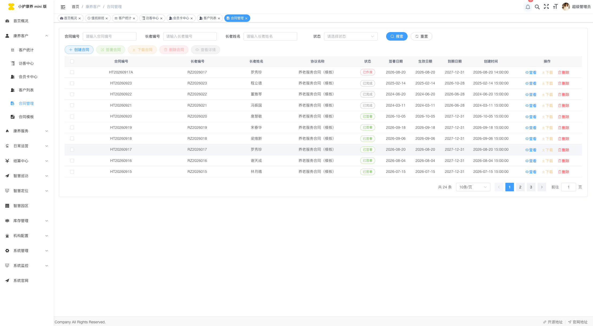
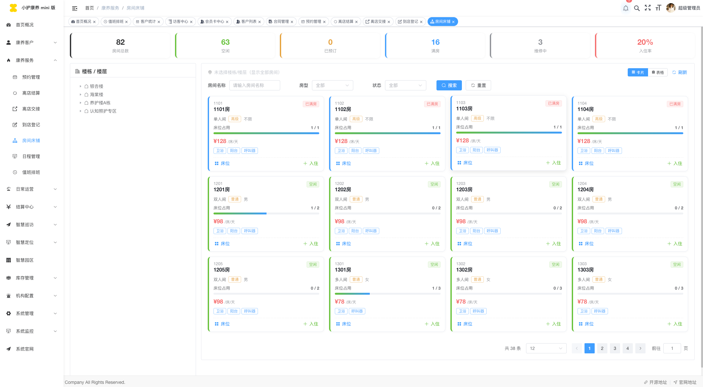
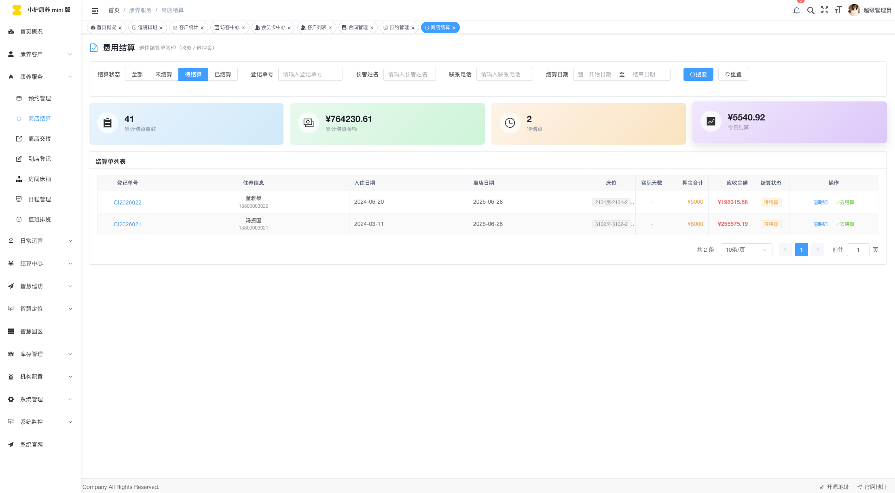
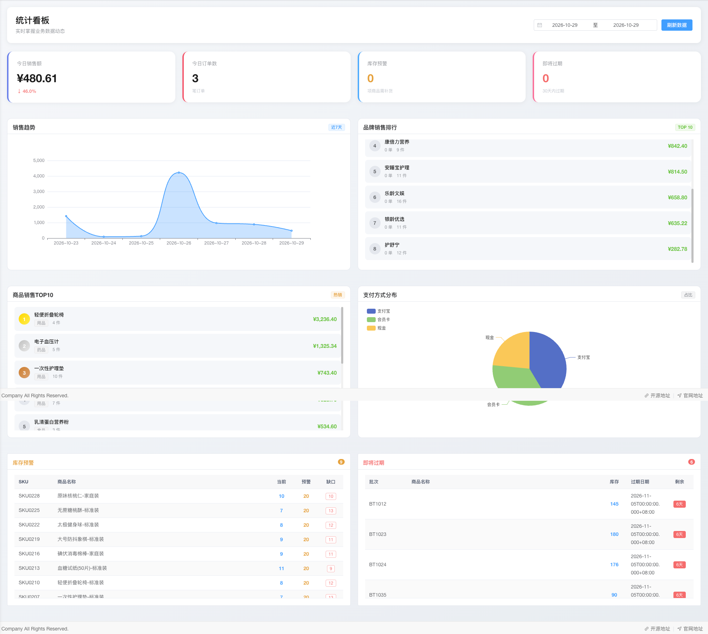

<div align="center">

# 🏥 xiaohucare-min · 小护康养 mini

**机构养老 / 康养业务后台服务**

覆盖入住合同、长者档案、护理活动、餐饮、物资仓储（WMS）、门禁与视频（大华 ICC）、
定位设备（GPS）、告警、值班排班、账务结算、报表看板等场景的开源业务后台。

基于 `Spring Boot 3` + `MyBatis-Plus` + `Spring Security 6` 构建，Maven 多模块分层。

[](#)
[](#)
[](#)
[](#)
[](#)
[](./LICENSE)

配套前端（Vue 3 + Element Plus 管理端）见姊妹仓库 `xiaohucare-mini-vue`（与本仓库同托管于 Gitee）。

> 本项目基于 RuoYi 开源生态改写，第三方依赖与上游归属详见 [NOTICE](./NOTICE)。
> 安全问题请按 [SECURITY.md](./SECURITY.md) 流程反馈。

</div>

---

## 📖 目录

- [项目预览](#-项目预览)
- [核心功能地图](#-核心功能地图)
- [技术栈](#-技术栈)
- [模块结构](#-模块结构)
- [快速开始](#-快速开始)
- [生产部署](#-生产部署)
- [代码规范](#-代码规范)
- [安全与合规](#-安全与合规)
- [状态与计划](#-状态与计划)
- [License](#-license)

---

## 📸 项目预览

> 以下截图来自配套管理端 `xiaohucare-mini-vue`，数据均为虚构演示数据。

| 工作台总览 | 住民档案 |
| :---: | :---: |
|  |  |

| 入住合同 | 楼栋 / 房间床位 |
| :---: | :---: |
|  |  |

| 每日护理排班 | 值班排班 |
| :---: | :---: |
|  |  |

| 退住结算 | 餐饮中心 |
| :---: | :---: |
|  |  |

| 台账报表 | GPS 围栏告警 |
| :---: | :---: |
|  |  |

| WMS 仓储看板 | 园区大屏 |
| :---: | :---: |
|  |  |

---

## 🧭 核心功能地图

| 领域 | 说明 | 对应模块 |
| --- | --- | --- |
| 🛏️ 入住管理 | 楼栋 / 房间 / 床位、入住登记、退住结算 | `intra-api` + `service/care` |
| 📝 合同计费 | 合同模板、签约、计费规则、费用总览与套餐 | `service/care` + `service/ledger` |
| 👴 长者档案 | 住民档案、家属、健康标签、统计报表 | `service/care` |
| 🩺 护理活动 | 每日排班、值班表、护理项目执行、交接班消息 | `service/care` |
| 🍚 餐饮中心 | 菜单、配餐、营养管理 | `intra-api` |
| 📦 物资仓储 | WMS 入库 / 出库 / 盘点 / 看板 | `intra-api` |
| 🎥 视频门禁 | 大华 ICC 视频、门禁、人脸、考勤对接 | `framework-plugs/video-dahua` |
| 📡 定位告警 | GPS 设备、电子围栏、实时告警（InfluxDB 时序可选） | `service/gps` |
| 💳 会员营销 | 会员卡、充值流水、访客中心 | `service/care` |
| 📊 台账报表 | 台账、报表导出（POI / EasyExcel）、园区大屏 | `service/ledger` |

---

## 🛠 技术栈

| 分类 | 选型 |
| --- | --- |
| 语言 / 运行时 | Java 17（可用 JDK 21 编译运行） |
| 框架 | Spring Boot 3.3.13、Spring Security 6、Spring MVC |
| 持久层 | MyBatis-Plus 3.5.15、dynamic-datasource 4.3.1、Druid 1.2.28、HikariCP |
| 数据库 | MySQL 8.x（必需）、InfluxDB（设备时序数据，可选） |
| 缓存 / 锁 | Redis 6+（必需）、Redisson 3.51、Lock4j |
| 鉴权 | JWT（jjwt 0.12.6），令牌密钥由环境变量注入 |
| 接口文档 | Knife4j 4.5.0 + springdoc-openapi 2.3.0（受 knife4j 兼容性约束，勿单独升 springdoc） |
| 任务调度 | XXL-JOB 2.5.0（可选） |
| 对象存储 | 本地 / 阿里云 OSS / 华为云 OBS / RustFS（S3 兼容） |
| 其他 | Hutool、fastjson2、Apache POI、EasyExcel 派生报表、Thymeleaf 模板、大华 ICC OpenAPI SDK |

---

## 📁 模块结构

```
xiaohucare-min/
├── xiaohucare-common/                     通用工具、常量、异常、基础注解（无业务依赖）
├── xiaohucare-framework/                  框架核心：安全、数据权限、MyBatis-Plus 增强、缓存、日志切面
├── xiaohucare-framework-plugs/
│   ├── xiaohucare-framework-http/         HTTP 客户端封装
│   ├── xiaohucare-framework-oss/          对象存储多实现（local / aliyun / huawei / rustfs）
│   └── xiaohucare-framework-video-dahua/  大华 ICC 视频、门禁、人脸、考勤对接
├── xiaohucare-service/                    领域服务层：care（照护）/ ledger（账务）/ gps（定位）/ cache
├── xiaohucare-intra-api/                  业务接口层（REST Controller）：照护、活动、餐饮、WMS、账务、官网
└── xiaohucare-platform/                   启动模块：MainApplication、系统管理、监控、Thymeleaf 页面、打包描述符
```

依赖方向（自上而下）：

```
platform ──▶ intra-api ──▶ service ──▶ framework ──▶ common
                              ▲
        framework-plugs（http / oss / video-dahua，按需引入）
```

不需要视频/门禁能力时，可在根 `pom.xml` 的 `<modules>` 中移除 `xiaohucare-framework-plugs` 下的
`xiaohucare-framework-video-dahua` 子模块，减少对大华 SDK 的依赖。

---

## 🚀 快速开始

### 环境要求

| 依赖 | 版本 | 必需 |
| --- | --- | :---: |
| JDK | 17+（兼容 21） | ✅ |
| Maven | 3.8+ | ✅ |
| MySQL | 8.x | ✅ |
| Redis | 6.x | ✅ |
| InfluxDB | - | ⭕ 可选（GPS 时序） |
| XXL-JOB | 2.5.0 | ⭕ 可选（调度） |

### 1️⃣ 初始化数据库

先建库（应用默认库名为 `xiaohucare_demo`，可用环境变量 `DB_NAME` 覆盖）：

```sql
CREATE DATABASE xiaohucare_demo DEFAULT CHARACTER SET utf8mb4 COLLATE utf8mb4_unicode_ci;
```

再导入初始化脚本（含 83 张表的建表结构与随附的初始化/演示数据）：

```bash
mysql -u <user> -p --default-character-set=utf8mb4 xiaohucare_demo < sql/xiaohucare_demo_init.sql
```

> [!NOTE]
> `sql/` 目录只包含结构与演示数据，其中姓名、身份证、手机号、银行卡与金额均为虚构，
> 仅供界面展示与功能自测，不含真实生产数据。发布前请自行复核。

### 2️⃣ 配置

所有密钥、地址、账号一律通过**环境变量**注入，不要写回 `application*.yml`：

```bash
cp .env.example .env      # .env 已被 .gitignore 忽略
# 至少填写：XIAOHUCARE_TOKEN_SECRET / DB_USERNAME / DB_PASSWORD / REDIS_PASSWORD
set -a; source .env; set +a
```

启动期做 fail-fast 校验：`token.secret` 缺失或长度不足 32 字节、Druid 监控开启但未配账号时，
应用会直接启动失败并提示修复方式。

生成 JWT 密钥：

```bash
openssl rand -base64 48
```

### 3️⃣ 运行

```bash
mvn -DskipTests clean install
mvn -pl xiaohucare-platform spring-boot:run
```

- 默认端口 `8187`，上下文 `/xiaohucare-api`；数据库默认连接 `xiaohucare_demo` 库（`DB_NAME` 可覆盖）
- 接口文档：<http://localhost:8187/xiaohucare-api/doc.html>（需 `KNIFE4J_ENABLE=true`，默认关闭）

> [!TIP]
> JDK 17+ 运行时若遇到 `InaccessibleObjectException`，需追加 `--add-opens` 参数，
> 完整清单见 [xiaohucare-platform/README.md](./xiaohucare-platform/README.md)。

### 4️⃣ 默认账号

种子数据仅创建一个超级管理员：

| 账号 | 口令 | 说明 |
| --- | --- | --- |
| `admin` | `Admin@123456` | ⚠️ 首次登录后请立即修改，并禁用/删除演示账号 |

---

## 📦 生产部署

```bash
mvn -pl xiaohucare-platform -am -DskipTests clean package
# 产物：xiaohucare-platform/target/xiaohucare-platform.zip
unzip xiaohucare-platform.zip -d /opt/xiaohucare && cd /opt/xiaohucare/xiaohucare-platform
chmod +x bin/*.sh
./bin/start.sh          # 启动；start.sh debug 开启远程调试；stop.sh 停止；restart.sh 重启
```

打包结构：`xiaohucare-platform.jar`（业务代码）+ `lib/`（依赖）+ `resources/`（模板、IP 库）+ `config/`（配置）+ `logs/`。
`config/application*.yml` 为生产模板，同样只写 `${ENV:默认}` 占位符，真实值经
`systemd EnvironmentFile`、Docker `-e` 或 shell `export` 注入。

部署最小建议清单：

- [ ] 关闭 `KNIFE4J_ENABLE`、`DRUID_MONITOR_ENABLED`、`spring-boot-devtools`
- [ ] 数据库账号按库/表授权，禁用 `root` 直连业务
- [ ] `XIAOHUCARE_PROFILE` 指向独立数据盘目录，并禁止该目录的脚本执行权限
- [ ] 反向代理层限制 `/doc.html`、`/druid/**` 的访问来源
- [ ] nginx 反向代理示例见 [`docs/deploy/nginx.conf.example`](docs/deploy/nginx.conf.example)，复制后替换域名与部署路径；
      `proxy_pass` 的后端端口与上下文路径需与 `SERVER_PORT`（默认 8187）、`SERVER_CONTEXT_PATH`（默认 `/xiaohucare-api`）一致。
      **请勿把带真实域名、证书路径的生产配置提交进仓库。**

---

## 🎨 代码规范

项目通过 Spotless 强制 Alibaba Java 格式化规范（import 顺序 `java > javax > jakarta > org > com`）：

```bash
mvn spotless:apply    # 自动修复
mvn spotless:check    # CI 校验
```

配置文件见 `code-style/`。提交 PR 前请保证 `mvn spotless:check` 与 `mvn -DskipTests package` 均通过。

---

## 🔐 安全与合规

- 配置文件**禁止明文密钥**，一律使用 `${ENV:default}`；新增敏感项请同步更新 `.env.example`
- 严禁提交生产数据库 dump、真实人员数据、日志文件（`.gitignore` 已拦截 `logs/`、`.local-backup/`、`*.key` 等）
- 涉及长者个人信息的导出、报表、日志打印需走脱敏工具（`DesensitizedType`），参考 [SECURITY.md](./SECURITY.md)
- 若你需要二次分发本项目的构建产物，请保留 `LICENSE` 与 `NOTICE`

---

## 🗺 状态与计划

- ⚠️ 单元测试覆盖率为 0，核心链路（合同计费、结算、库存出入库）缺少回归用例，**欢迎贡献**
- 未来计划：
  - 迁移到 springdoc 原生 UI，以解锁 Spring Boot 3.4 / 3.5 升级线
  - 拆分前端菜单初始化脚本
  - 补齐 CI（编译 + `spotless:check` + 依赖漏洞扫描）

---

## 📄 License

Copyright 2026 xiaohucare

Licensed under the [Apache License, Version 2.0](./LICENSE). 第三方依赖与上游归属详见 [NOTICE](./NOTICE)。
